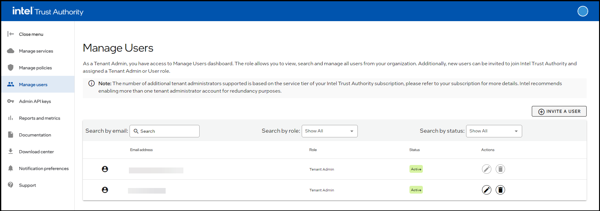
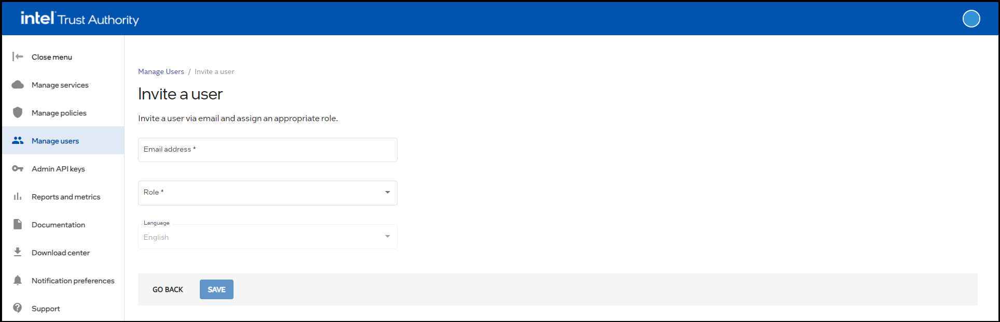

import Tabs from '@theme/Tabs';
import TabItem from '@theme/TabItem';

Trust Authority (TA) assigns each user one of two roles: Tenant Admin or User. Tenant admins can perform all regular user functions and manage other users through the **Manage users** dashboard. Your tenant must have at least one active tenant admin. TA automatically assigns this role to the first TA subscriber from a tenant organization. Only tenant admins can invite, edit, and delete users.

:::important
Enable more than one tenant admin account for redundancy.
:::

You can manage users in the TA portal, with the [CLI](../Command-line/cli-user-commands.md), or by using the REST API. This article provides instructions for the portal and CLI. Select the tab for your preferred method.

<Tabs>
  <TabItem value="portal" label="TA portal" default>

## Portal

### View tenant admins and users

To view the list of users:

1. Sign in as a tenant admin.

1. Select **Manage users**.

   

   The table lists each user, their role, and their status.

### Create a user

To create a user:

1. Sign in as a tenant admin.

1. Select **Manage users**.

1. Select **INVITE A USER**.

   

1. Enter the user's email address.

1. Select the role for the new user.

1. (Optional) Select a language for the user.

1. Select **SAVE**.

   TA emails the invitation to the user.

### Search for users

You can search for TA users within your tenant by filtering by email, role, or status. To search for users in the TA portal:

1. Sign in as a tenant admin.

1. Select **Manage users**.

1. In the **Manage users** dashboard, filter users by using any of the following options:

   - **Search by email**: In the **Search by email** box, enter the user's email address. Search results update as you type, starting with the first character. The table displays users whose email addresses match.
   - **Search by role**: From the menu, select a role option (**Show All**, **Tenant Admin**, or **User**). The table displays users with the selected role.
   - **Search by status**: From the menu, select a status option (**Show All**, **Active**, or **Pending**). The table displays users with the selected status.

### Update user roles

To update a user's role:

1. Sign in as a tenant admin.

1. Select **Manage users**.

1. Identify the user to update.

1. Select the **Edit** icon .

1. In the dialog box, select **YES, EDIT**.

1. From the menu, select the new role.

1. Select **SAVE**.

   TA updates the user and displays the updated information in the **Active Users** pane.

### Delete a user

To delete a user:

1. Sign in as a tenant admin.

1. Select **Manage users**.

1. Identify the user to delete.

1. Select the **Delete** icon .

1. In the dialog box, select **YES, DELETE USER**.

   TA deletes the user and removes them from the **Active Users** pane.

:::note
Deleting a user does **not** delete the user's policies, tags, or API keys.
:::

</TabItem>

<TabItem value="cli" label="CLI">

## CLI

The sample responses use example email addresses and redacted identifiers, timestamps, and trace IDs.

### View tenant admins and users

This command lists the current users in your tenant:

```bash
tactl list user
```

#### Sample call

```bash
tactl list user
```

#### Sample response

```text
trace-id:  <redacted trace ID>
Users:
[
  {
    "id": "<redacted user ID>",
    "email": "user@example.com",
    "tenant_roles": [
      {
        "tenant_id": "<redacted tenant ID>",
        "roles": [
          {
            "id": "<redacted role ID>",
            "name": "Tenant Admin"
          }
        ]
      }
    ],
    "active": true,
    "created_at": "<redacted timestamp>"
  },
  {
    "id": "<redacted user ID>",
    "email": "user@example.com",
    "tenant_roles": [
      {
        "tenant_id": "<redacted tenant ID>",
        "roles": [
          {
            "id": "<redacted role ID>",
            "name": "Tenant Admin"
          }
        ]
      }
    ],
    "active": false,
    "created_at": "<redacted timestamp>"
  },
  {
    "id": "<redacted user ID>",
    "email": "user@example.com",
    "tenant_roles": [
      {
        "tenant_id": "<redacted tenant ID>",
        "roles": [
          {
            "id": "<redacted role ID>",
            "name": "User"
          }
        ]
      }
    ],
    "active": false,
    "created_at": "<redacted timestamp>"
  },
  {
    "id": "<redacted user ID>",
    "email": "user@example.com",
    "tenant_roles": [
      {
        "tenant_id": "<redacted tenant ID>",
        "roles": [
          {
            "id": "<redacted role ID>",
            "name": "Tenant Admin"
          }
        ]
      }
    ],
    "active": false,
    "created_at": "<redacted timestamp>"
  },
  {
    "id": "<redacted user ID>",
    "email": "user@example.com",
    "tenant_roles": [
      {
        "tenant_id": "<redacted tenant ID>",
        "roles": [
          {
            "id": "<redacted role ID>",
            "name": "Tenant Admin"
          }
        ]
      }
    ],
    "active": false,
    "created_at": "<redacted timestamp>"
  },
  {
    "id": "<redacted user ID>",
    "email": "user@example.com",
    "tenant_roles": [
      {
        "tenant_id": "<redacted tenant ID>",
        "roles": [
          {
            "id": "<redacted role ID>",
            "name": "User"
          }
        ]
      }
    ],
    "active": false,
    "created_at": "<redacted timestamp>"
  },
  {
    "id": "<redacted user ID>",
    "email": "user@example.com",
    "tenant_roles": [
      {
        "tenant_id": "<redacted tenant ID>",
        "roles": [
          {
            "id": "<redacted role ID>",
            "name": "Tenant Admin"
          }
        ]
      }
    ],
    "active": false,
    "created_at": "<redacted timestamp>"
  }
]
```

### Create a user (CLI)

Use the following command to create a user in your tenant:

```bash
tactl create user -e "<email address>" -r "<role>"
```

Use `Tenant Admin` or `User` as the role.

#### Sample call

```bash
tactl create user -e user@example.com -r User
```

#### Sample response

```text
trace-id:  <redacted trace ID>
User:

{
  "id": "<redacted user ID>",
  "email": "user@example.com",
  "role": {
    "id": "<redacted role ID>",
    "name": "User"
  },
  "active": false,
  "created_at": "<redacted timestamp>",
  "privacy_acknowledgement": false
}
```

### Update user roles (CLI)

Use the following command to update the role of a specified user:

```bash
tactl update user role -u "<user ID>" -r "<role>"
```

#### Sample call

```bash
tactl update user role -a "<redacted admin API key>" -u "<user ID>" -r "Tenant Admin"
```

#### Sample response

```text
trace-id:  <redacted trace ID>
Updated User:
{
  "id": "<redacted user ID>",
  "email": "user@example.com",
  "tenant_roles": [
    {
      "tenant_id": "<redacted tenant ID>",
      "roles": [
        {
          "id": "<redacted role ID>",
          "name": "Tenant Admin"
        }
      ]
    }
  ],
  "active": false,
  "created_at": "<redacted timestamp>"
}
```

### Delete a user (CLI)

This command deletes the specified user from the tenant you're signed in to:

```bash
tactl delete user -u "<user ID>"
```

#### Sample call

```bash
tactl delete user -a "<redacted admin API key>" -u "<user ID>"
```

#### Sample response

```text
trace-id:  <redacted trace ID>
User <user ID> deleted
```

  </TabItem>
</Tabs>
