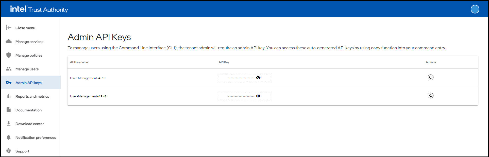
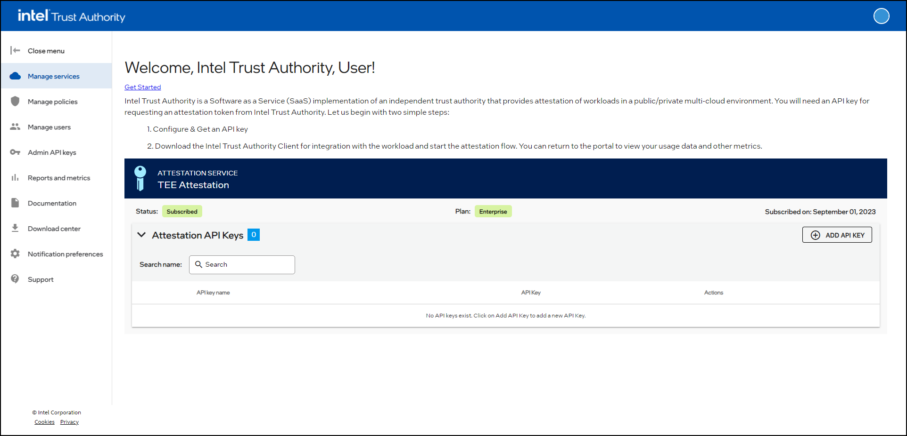
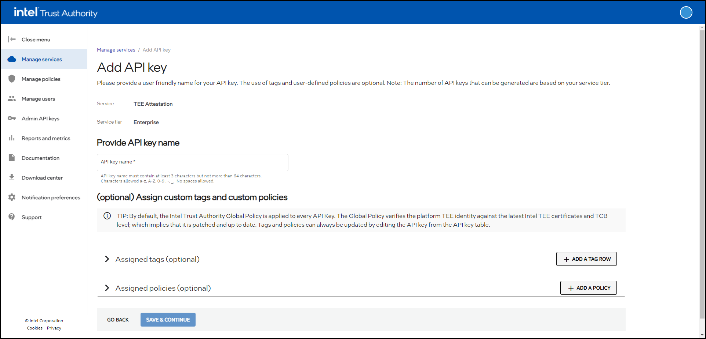

import Tabs from '@theme/Tabs';
import TabItem from '@theme/TabItem';

This quickstart walks through a sample workflow for generating your
first attestation with TA.

## Admin API key management

Admin API keys are required to manage non-attestation functions in TA.
These functions include creating attestation API keys, inviting users,
changing user permissions, managing policies, and managing subscription
levels.

:::note
Rotate the admin API keys whenever a Tenant Admin user is removed or downgraded to User. The admin API keys that the former Tenant Admin could access remain active and usable unless you rotate them.
:::

An admin API key is the only authorization required to run nearly all
REST APIs. Attestation-related APIs require an attestation API key
instead. An admin API key can't be used to attest a TEE. You can perform
nearly any portal operation through the TA REST API, except retrieving
an attestation API key's value, which you can do only in the portal.

### View admin API keys

1. Sign in to the TA Portal.

    :::note
    The portal works best with Google Chrome, Microsoft Edge, Mozilla
    Firefox, and Safari.
    :::

1. Select **Admin API keys**.

1. View the API keys in the table.

    

### Copy admin API keys {/*#admin-keys*/}

1. Sign in to the TA Portal.

1. Select **Admin API keys**.

1. Go to the API key that you want to copy.

1. Select the  icon for
   the API key.

    The API key appears.

1. Select the  icon.

    The API key is copied to the clipboard.

You can use the admin API key with the `tactl` CLI to manage admins and
users.

<a id="attest-api-keys"></a>

## Attestation API keys

Attestation API keys authenticate attestation-related functions,
including generating an attestation token, creating a signed nonce, and
requesting a Faithful Verification token audit report. Include an
attestation API key with all attestation-related requests. It lets you
attest any supported TEE.

You can create an attestation API key in the portal or by using the REST
API, but you can retrieve its value only from the portal. This
restriction prevents a rogue client from creating and using an
attestation key. A client can obtain and use a new attestation key only
when a user with portal access transfers it to the client.

You can associate one or more attestation policies with an attestation
API key. Associated policies apply to all attestation requests that the
key authorizes. You can also specify policies in an attestation request.
When you do, the policies in the request replace the associated
policies; only the request policies are evaluated.

Attestation API keys can also have tags for reporting and metrics. All
API keys have at least one tag: the default **Workload** tag.

<Tabs>
<TabItem value="portal" label="Portal" default>

### Create an attestation API key

Any user can create attestation API keys that are available to all users
in the tenant organization.

1. Sign in to the TA Portal.

1. Select **Manage services**.

    

1. Select **ADD API KEY**.

    The **Add API key** page appears.

    

1. Enter a name for the API key. It must contain 3 to 64 characters.
   Use letters and numbers; spaces and special characters aren't
   supported, except underscores (_) and hyphens (-).

1. (Optional) Assign one or more tags to the API key. Tags are
   key-value pairs that help track usage in reports and metrics. The
   **Workload** tag is predefined. You can use an application's name as
   its value to track the attestations that the application requests.
   For more information, see Tag management.

1. (Optional) Assign one or more policies to the API key. Use the
   **Select an existing policy** list to choose an existing policy, or
   select **Create a new policy**. For more information, see Policy
   management.

1. Select **SAVE & CONTINUE**.

1. Review the information on the **Confirm API key details** page.

1. If the information is correct, select **SUBMIT**.

    TA creates the API key, along with any new tags or policies.

</TabItem>

<TabItem value="restapi" label="REST API">

### Create an attestation API key with the REST API

Creating an attestation API key with the REST API requires an admin API
key for authentication.

1. (Optional) Create tags or policies to associate with the attestation
   API key, and retrieve their IDs.

1. Retrieve the available service offers with
   `GET /management/v1/service-offers` and note the ID of the offer you
   want to use.

1. Retrieve the services subscribed to by your tenant with
   `GET /management/v1/services`. Find the service associated with the
   offer and note its `id` as the `serviceId`.

1. Retrieve the products for the offer with
   `GET /management/v1/service-offers/{serviceOfferId}/products` and
   note the required product ID.

1. Create the API client with
   `POST /management/v1/services/{serviceId}/api-clients`. Replace
   `<TA_API_URL>`, `<service-id>`, and `<product-id>` in this example.
   The request requires an admin API key:

   ```bash
   curl --location --request POST '<TA_API_URL>/management/v1/services/<service-id>/api-clients' \
     --header 'Accept: application/json' \
     --header 'Content-Type: application/json' \
     --header 'x-api-key: <admin API key>' \
     --data '{
       "name": "<API client name>",
       "product_id": "<product-id>",
       "policy_ids": [],
       "tags": []
     }'
   ```

   The API client is created. Retrieve its API key value from the TA
   Portal.

</TabItem>

</Tabs>

:::note
A new attestation API key can take up to two minutes to become active.
:::

## Request an attestation

This example shows how to attest an SGX enclave using either the REST
API or the Go client library.

<Tabs>
<TabItem value="restapi" label="REST API">

### REST API

Use the TA REST API to request an attestation. This example assumes that
you have an SGX application that can retrieve an SGX quote.

1. Request a nonce.

   ```bash
   curl --location 'https://api.ta.company.com/appraisal/v1/nonce' \
     --header 'Accept: application/json' \
     --header 'x-api-key: <attestation API key>'
   ```

   :::note
   If you're in the European Union (EU) region, use the following URL
   instead:

   ```bash
   curl --location 'https://api.eu.ta.company.com/appraisal/v1/nonce' \
     --header 'Accept: application/json' \
     --header 'x-api-key: <attestation API key>'
   ```

   :::

   Sample response:

   ```json
   {
    "val": "<nonce value>",
    "iat": "<issue time>",
    "signature": "<nonce signature>"
   }
   ```

1. Retrieve an SGX quote from an SGX-enabled application. TA expects the
   quote's report data to contain the SHA-256 hash of the nonce and user
   data. In the REST request, `runtime_data` carries the user data in
   Base64-encoded form. Use the TA SGX evidence adapter to construct the
   quote and report data; see the [Go SGX adapter API
   reference](../Integration/integrate-go-client.md#go-sgx-adapter-api-reference).

1. Request an attestation token.

   ```bash
   curl --location 'https://api.ta.company.com/appraisal/v1/attest' \
     --header 'Accept: application/json' \
     --header 'x-api-key: <attestation API key>' \
     --header 'Content-Type: application/json' \
     --data '{
       "quote": "<full SGX quote>",
       "verifier_nonce": {
         "val": "<from nonce request>",
         "iat": "<from nonce request>",
         "signature": "<from nonce request>"
       },
       "policy_ids": [],
       "runtime_data": "<Base64-encoded SGX user data>"
     }'
   ```

</TabItem>

<TabItem value="go" label="Go client">

### Go client

Use the TA Go client library to request an attestation token. This
example assumes that you integrated the client, including the `go-sgx`
module, with an SGX-enabled application.

For more code samples, see the [TA client repo](https://github.com/ta-client-for-go/tree/main).

1. Instantiate the client.

   ```go
   cfg := connector.Config{
       // Replace TRUSTAUTHORITY_URL with the actual TA URL.
       BaseUrl: "TRUSTAUTHORITY_URL",
       // Replace TRUSTAUTHORITY_API_URL with the actual TA API URL.
       ApiUrl: "TRUSTAUTHORITY_API_URL",
       // Provide the TLS configuration.
       TlsCfg: &tls.Config{},
       // Replace TRUSTAUTHORITY_API_KEY with the actual API key.
       ApiKey: "TRUSTAUTHORITY_API_KEY",
       // Provide the retry configuration.
       RClient: &RetryConfig{},
   }
   ```

1. Request a new signed nonce.

   ```go
   nonce, err := connector.GetNonce()
   if err != nil {
       fmt.Printf("Error getting nonce: %s\n\n", err)
       return err
   }
   ```

1. Collect evidence from the enclave.

   ```go
   adapter, err := sgx.NewEvidenceAdapter(enclaveId, enclaveHeldData, unsafe.Pointer(C.enclave_create_report))
   if err != nil {
       return err
   }

   evidence, err := adapter.CollectEvidence(nonce)
   if err != nil {
       return err
   }
   ```

1. Request an attestation token using the nonce and evidence. No
   additional attestation policies are evaluated unless you set the
   `policyIds` variable.

   ```go
   token, err := connector.GetToken(nonce, policyIds, evidence)
   if err != nil {
       fmt.Printf("Error getting attestation token: %s\n\n", err)
       return err
   }
   ```

1. Verify the attestation token. This step checks the token's issue time
   and signature.

   ```go
   // Download the token signing certificates
   jwks, err := connector.GetTokenSigningCertificates()
   if err != nil {
       fmt.Printf("Error getting token signing certificates: %s\n\n", err)
       return err
   }

   parsedToken, err := connector.VerifyToken(string(token))
   if err != nil {
       fmt.Printf("Error verifying token: %s\n\n", err)
       return err
   }
   ```

</TabItem>

</Tabs>

## Change your password

After you change your password, you might be unable to sign in to the TA
Portal. If this occurs, close all browser windows, then open a new
window and sign in with your updated password. If you still can't sign
in, contact support.
