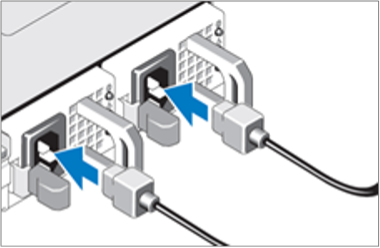
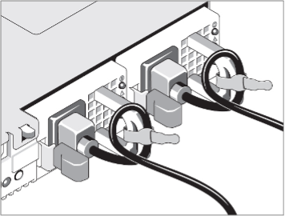

This guide will help you install your Data Indexer Appliance
and direct you to additional information.

## Unpack the Appliance

Unpack your appliance, keeping all shipping materials in case you need
them later.

Your Indexer Appliance ships with a rack-mount chassis and rails for
installing the appliance in a high-density server rack. Depending on
your appliance model, the rack kit includes some or all of the
following:

- One pair of sliding rail assemblies

- Nylon Velcro straps

## Install the Appliance in a Server Rack

**NOTE**: Please refer to the Rack Installation Instructions that are
included with your Indexer Appliance for additional information about
installing the rails, installing the appliance, and routing cables.

Before you install the appliance, make sure that your rack meets the
following specifications:

- American National Standards Institute (ANSI)/Electronic Industries
  Association (EIA) standard 310-D-92

- International Electrotechnical Commission (IEC) 297

- Deutsche Industrie Norm (DIN) 41494

## Power on the Appliance

Your new LogRhythm Appliance is equipped with a redundant power supply
configuration, which consists of two individual hot-swap components. For
hot-swapping to occur, each of the two power supplies must be powered
with its own cord. LogRhythm recommends using a fault-tolerant power
source, such as an Uninterrupted Power Supply (UPS).

1. Connect the power cables.

    

1. Bend the system power cable into a loop as shown below, then secure
    the cable in the provided strap.

    

1. Plug the other end of the cables into a grounded electrical outlet
    or a separate power source, such as an Uninterrupted Power Supply
    (UPS) or a Power Distribution Unit (PDU).

1. Turn on the system by pressing the power button.

The power indicators should light up.

## Complete the Initial Appliance Configuration

Your new Indexer Appliance comes from the factory pre-installed with:

- CentOS 7.1

- LogRhythm Data Indexer Software Installation Script

Upon your first login to the Indexer Appliance, you must provide
configuration details that are specific to your network and
organization.

**Important**: You should not skip the initial configuration script
after logging in to the Indexer Appliance. If you do, your Indexer will
be configured to use DHCP on the primary Ethernet adapter, which is not
a supported configuration for a production environment.

If you experience any problems with your new appliance during initial
setup, contact LogRhythm Support.

To complete the initial appliance configuration, do the following:

1. When prompted to log in, type **logrhythm** for the login and the
    default LogRhythm password for Password.

1. Press **y** to run the script.

You will be prompted for network and NTP details. At each prompt,
detected or default values are displayed in parentheses. To accept these
values, simply press **Enter**.

1. Enter the network and NTP information, as follows:

  | Prompt          | Description                                                                                                                        |
  | :-------------- | :--------------------------------------------------------------------------------------------------------------------------------- |
  | IP address      | The IP address that you want to assign to this Data Indexer node.                                                                  |
  | Netmask         | The netmask to use.                                                                                                                |
  | Default gateway | The IP address of the network gateway.                                                                                             |
  | NTP servers     | The IP address of one or more NTP servers. Enter each server address, then press **Enter**. When finished, press **Ctrl** + **D**. |

> After completing the items in the configuration script, the system
> will test connectivity to the default gateway and the NTP servers. If
> any of the tests fail, press **n** when prompted to enter addresses
> again.
>
> **NOTE:** If you plan to deploy the Indexer in a different network
> environment and you expect the connectivity tests to fail, you can
> press **y** to proceed.
>
> After confirming the gateway and NTP values, you will be logged in as
> the logrhythm user.

1. Restart the network interfaces to apply the new settings: sudo
    systemctl restart network

1. Restart chrony to apply NTP changes: sudo systemctl restart chronyd

1. If you are installing a cluster of Indexers, repeat the initial
    configuration on each Indexer node.

1. When you have completed the initial configuration of all Indexer
    nodes, proceed as needed:

- [Install a Single-node Cluster](#install-a-single-node-cluster)

- [Install a Multi-node Cluster](#install-a-multi-node-cluster)

## Install a Single-node Cluster

1. Change to the **Soft** directory: cd Soft

1. Run the Data Indexer installer: sudo sh
    LRDataIndexer-*version*.centos.x86_64.run

> You can press the **Tab** key after starting to type out the installer
> name, and the filename will be autocompleted for you.

1. When prompted for the IP address of a cluster node, enter the IP
    address of the machine you are currently logged into.

1. Type **q** when prompted for another IP address.

1. If prompted for the SSH password, enter the password for the
    logrhythm user.

The script will install the Indexer software.

**NOTE:** The installation process may take up to 10 minutes.

When the installation is complete, the following message is displayed:

> Successfully installed LogRhythm(R) Data Indexer software!

## Install a Multi-node Cluster

**NOTE:** You only need to run the installer package on ONE of your
cluster nodes. The package installer will install the Indexer software
on each node in your cluster.

1. Change to the **Soft** directory: cd Soft

1. Using sudo, create a file in the current directory ---
    /home/logrhythm/Soft --- called hosts.

The file should contain all of the IP addresses of the hosts in the
cluster. If you want to specify the hostnames of the cluster nodes,
enter it after each IP address and separate the address and hostname
with a space. If you do not specify the hostnames, the installer will
rename the hosts.

The file might look like the following:

> 10.1.23.65 LRLinux1\
> 10.1.23.67 LRLinux2\
> 10.1.23.91 LRLinux3

1. Run the installer with the hosts file argument as follows:

sudo sh LRDataIndexer-*version*.centos.x86_64.run \-- \--hosts
/home/logrhythm/Soft/hosts

> You can press the **Tab** key after starting to type out the installer
> name, and the filename will be autocompleted for you.

1. If prompted for the SSH password, enter the password for the
    logrhythm user.

The script will install Indexer software on each node specified in the
hosts file.

**NOTE:** The installation process may take 30 minutes or longer to
complete.

When the installation is complete, the following message is displayed:

> Successfully installed LogRhythm(R) Data Indexer software!

## Create a LogRhythm Support Account

The LogRhythm Support site has the most current help documentation,
software revisions, patches, and other important information.

To become a registered user, log in to the [LogRhythm Support site](https://support.logrhythm.com).

1. Click **Request a New Account**.

1. Complete the request form.

> Your registration confirmation will be emailed to you.

1. If you have not received an email for your account, check your spam
    folder. Contact support if you still have not received it within a
    reasonable amount of time.

## Proceed with Deployment Setup

See *Getting Started: LogRhythm Appliance Software Configuration* on the
LogRhythm Support site for further instructions.

LogRhythm Inc., 4780 Pearl East Circle, Boulder, CO 80301

[www.logrhythm.com](http://www.logrhythm.com) \| (303) 413-8745 \|
[support@logrhythm.com](mailto:support@logrhythm.com)

© LogRhythm, Inc. All rights reserved

This document contains proprietary and confidential information of
LogRhythm, Inc., which is protected by copyright and possible
non-disclosure agreements. The Software described in this Guide is
furnished under the End User License Agreement or the applicable Terms
and Conditions ("Agreement") which governs the use of the Software. This
Software may be used or copied only in accordance with the Agreement. No
part of this Guide may be reproduced or transmitted in any form or by
any means, electronic or mechanical, including photocopying and
recording for any purpose other than what is permitted in the Agreement.

## Disclaimer

The information contained in this document is subject to change without
notice. LogRhythm, Inc. makes no warranty of any kind with respect to
this information. LogRhythm, Inc. specifically disclaims the implied
warranty of merchantability and fitness for a particular purpose.
LogRhythm, Inc. shall not be liable for any direct, indirect,
incidental, consequential, or other damages alleged in connection with
the furnishing or use of this information.

## Trademark

LogRhythm is a registered trademark of LogRhythm, Inc. All other company
or product names mentioned may be trademarks, registered trademarks, or
service marks of their respective holders.
