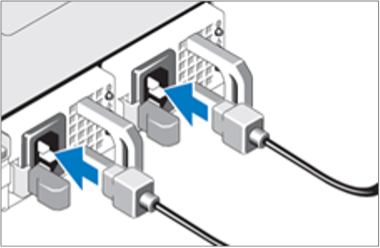
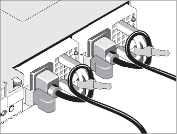

This guide explains how to install and configure your Data Indexer appliance.

## Unpack the appliance

Unpack your appliance, keeping all shipping materials in case you need
them later.

Your Indexer appliance ships with a rack-mount chassis and rails for
installation in a high-density server rack. Depending on your appliance
model, the rack kit includes some or all of the following:

- One pair of sliding rail assemblies

- Nylon Velcro straps

## Install the appliance in a server rack

:::note
For details about installing the rails and appliance and routing
cables, see the Rack Installation Instructions included with your
Indexer appliance.
:::

Before you install the appliance, make sure that your rack meets the
following specifications:

- American National Standards Institute (ANSI)/Electronic Industries
  Association (EIA) standard 310-D-92

- International Electrotechnical Commission (IEC) 297

- Deutsche Industrie Norm (DIN) 41494

## Power on the appliance

Your new LogRhythm appliance has a redundant power supply configuration
with two hot-swappable power supplies. For hot swapping to work, connect
each power supply to its own power cord. LogRhythm recommends using a
fault-tolerant power source, such as an uninterruptible power supply
(UPS).

1. Connect the power cables.

    

1. Bend each system power cable into a loop as shown below, then secure
    the cable in the provided strap.

    

1. Plug the other end of the cables into a grounded electrical outlet
    or a separate power source, such as an uninterruptible power supply
    (UPS) or a Power Distribution Unit (PDU).

1. Turn on the system by pressing the power button.

The power indicators should light up.

## Complete the initial appliance configuration

Your new Indexer appliance comes with the following software
preinstalled:

- CentOS 7.1

- LogRhythm Data Indexer Software Installation Script

When you first sign in to the Indexer appliance, provide
configuration details that are specific to your network and
organization.

:::warning[Important]
Do not skip the initial configuration script after logging in to the
Indexer appliance. Otherwise, the Indexer uses DHCP on the primary
Ethernet adapter, which is not supported in a production environment.
:::

If you experience any problems with your new appliance during initial
setup, contact LogRhythm Support.

To complete the initial appliance configuration, do the following:

1. When prompted, enter the appliance account name and default password
    provided for your installation.

1. Press **y** to run the script.

The script prompts you for network and NTP details. At each prompt,
detected or default values are displayed in parentheses. To accept these
values, press **Enter**.

1. Enter the network and NTP information as follows:

    | Prompt          | Description                                                                                                      |
    | :-------------- | :--------------------------------------------------------------------------------------------------------------- |
    | IP address      | The IP address to assign to this Data Indexer node.                                                              |
    | Netmask         | The netmask to use.                                                                                              |
    | Default gateway | The IP address of the network gateway.                                                                           |
    | NTP servers     | Enter each NTP server IP address and press **Enter**. When finished, press **Ctrl** + **D**.                     |

    :::note
    After you complete the configuration script, the system tests
    connectivity to the default gateway and NTP servers. If any test
    fails, press **n** when prompted to enter the addresses again.

    If you plan to deploy the Indexer in a different network environment
    and expect the connectivity tests to fail, press **y** to proceed.

    After you confirm the gateway and NTP values, you are signed in to
    the appliance.
    :::

1. Restart the network interfaces to apply the new settings:

    ```bash
    sudo systemctl restart network
    ```

1. Restart chrony to apply the NTP changes:

    ```bash
    sudo systemctl restart chronyd
    ```

1. If you are installing a cluster of Indexers, repeat the initial
    configuration on each Indexer node.

1. When you have completed the initial configuration of all Indexer
    nodes, proceed as needed:

    - [Install a single-node cluster](#install-a-single-node-cluster)

    - [Install a multi-node cluster](#install-a-multi-node-cluster)

## Install a single-node cluster

1. Change to the **Soft** directory:

    ```bash
    cd Soft
    ```

1. Run the Data Indexer installer:

    ```bash
    sudo sh LRDataIndexer-*version*.centos.x86_64.run
    ```

    Press **Tab** after you begin typing the installer name to
    autocomplete the filename.

1. When prompted for the IP address of a cluster node, enter the IP
    address of the machine you are currently logged into.

1. Type **q** when prompted for another IP address.

1. If prompted for the SSH password, enter the password for the
    appliance account.

The script will install the Indexer software.

:::note
The installation process may take up to 10 minutes.
:::

When the installation is complete, the following message is displayed:

> Successfully installed LogRhythm(R) Data Indexer software!

## Install a multi-node cluster

:::note
Run the installer package on only one cluster node. The installer
installs the Indexer software on each node in the cluster.
:::

1. Change to the **Soft** directory:

    ```bash
    cd Soft
    ```

1. Using `sudo`, create a file named `hosts` in the current directory
    (`~/Soft`).

    The file should contain the IP addresses of all hosts in the
    cluster. To specify hostnames for the cluster nodes, enter each
    hostname after its IP address, separated by a space. If you do not
    specify hostnames, the installer will rename the hosts.

    For example, replace the placeholders with each node's IP address
    and hostname:

    ```text
    <node-1-ip> <node-1-hostname>
    <node-2-ip> <node-2-hostname>
    <node-3-ip> <node-3-hostname>
    ```

1. Run the installer with the hosts file argument as follows:

    ```bash
    sudo sh LRDataIndexer-*version*.centos.x86_64.run -- --hosts "$HOME/Soft/hosts"
    ```

    Press **Tab** after you begin typing the installer name to
    autocomplete the filename.

1. If prompted for the SSH password, enter the password for the
    appliance account.

The script will install Indexer software on each node specified in the
hosts file.

:::note
The installation process may take 30 minutes or longer to complete.
:::

When the installation is complete, the following message is displayed:

> Successfully installed LogRhythm(R) Data Indexer software!

## Create a LogRhythm Support account

The LogRhythm Support site has the most current help documentation,
software revisions, patches, and other important information.

To become a registered user, log in to the [LogRhythm Support site](https://support.logrhythm.com).

1. Select **Request a New Account**.

1. Complete the request form. You will receive your registration
    confirmation by email.

1. If you have not received an email for your account, check your spam
    folder. Contact support if you still have not received it within a
    reasonable amount of time.

## Proceed with deployment setup

See *Getting Started: LogRhythm Appliance Software Configuration* on the
LogRhythm Support site for further instructions.

> [Proprietary contact information and legal notice redacted.]

## Disclaimer

> [Proprietary disclaimer text redacted.]

## Trademark

> [Proprietary trademark notice redacted.]
