This guide describes how to install and configure the LogRhythm Disaster
Recovery (DR) solution. The solution helps organizations recover key
LogRhythm SIEM databases and continue collecting logs after a site
failure, such as a power outage, fire, or flood.

## Intended audience

This guide is for LogRhythm Professional Services staff who install and
configure the DR solution for customers. LogRhythm customers can also
use it to learn about the solution.

## Overview of steps

1. **Understand the Disaster Recovery solution architecture.** If you
    are configuring the DR solution for the first time, read this
    section to become familiar with the DR architecture.

1. **Meet system requirements and prepare the SIEM environment.**
    Before installing the DR solution, make sure the environment meets
    all the prerequisites:

    - All LogRhythm components are using the same SIEM version.

    - The SQL Server service runs under the same account at the Primary
      and Secondary sites.

    - The SQL Server Agent service runs under the same account at the
      Primary and Secondary sites.

    - A network interface (NIC port) is dedicated to data replication
      between the Primary and Secondary sites (recommended so that
      normal Platform Manager traffic is separate from replicated
      traffic).

    - The ports used for replication between the two sites are open and
      not blocked by a firewall. DR Setup automatically opens ports
      blocked by Windows Firewall, but it does not configure other
      firewalls.

    - A common DNS record that can point to the IP address of either the
      Primary Platform Manager or the IP address of the Secondary
      Platform Manager.

    - The Data Indexers and AI Engines are configured to connect to the
      Platform Manager by DNS name rather than IP address.

    - The DNS zone spans the Primary and Secondary sites.

    - A TTL (Time to Live) is configured in DNS records.

    :::Important
    Use only static IP addresses for the replication interface. Do not use DHCP.
    :::

1. **Install and configure the Disaster Recovery software.** During
    installation, you will perform the following steps:

    - Configure the Primary system.

    - Transfer the LogRhythm database backup files to the Secondary
      system.

    - Configure the Secondary system.

    - Complete the setup on the Primary system.

1. **Register the LogRhythm databases (optional).** Registration lets
    you view detailed status information in the SQL Database Mirroring
    Monitor.

1. **Test the DR solution (recommended).** Test the configuration to
    confirm that it works as expected.

1. **Upgrade the DR test systems.** Perform DR upgrade testing.

    - Stop LogRhythm services on both nodes. Pay close attention to
      which services should run on each node. For example, `scarm` and
      `lrjobmgr` do not run on the passive node, but all other services
      do.

    - Run Upgrade Assistant on the active node.

    - Manually run the Build_CMDB and BuildEMDB scripts on the passive node.

    - Run LRI on both nodes.

    - Start the appropriate services (as noted above) on each node.

## Definition of terms

The following table describes terms used in this guide.

| Term                    | Definition                                                                                                                                                                                                                                                                                                                                                                                                             |
| :---------------------- | :--------------------------------------------------------------------------------------------------------------------------------------------------------------------------------------------------------------------------------------------------------------------------------------------------------------------------------------------------------------------------------------------------------------------- |
| Disaster recovery sites | The solution uses two sites. **Primary** is the main site that collects and processes log data. **Secondary** is the mirrored site that can be available if the Primary site fails.                                                                                                                                                                                                                                    |
| System status           | **Active** describes the site currently collecting and processing log data. The Primary site is usually active unless failover has occurred. **Standby** describes a system available to collect and process log data.                                                                                                                                                                                                 |
| Site types              | **Cold:** Available, but possibly powered off or unconfigured. **Warm:** Configured, but unable to become active until it receives the Primary site's backup files. **Hot:** Mirrored and able to become active within minutes. The Secondary site in the LogRhythm DR solution is a hot site.                                                                                                                         |
| Recovery objectives     | **Recovery Point Objective (RPO):** The maximum tolerable period of data loss from the Primary site after a disruption. **Recovery Time Objective (RTO):** The maximum period a site can be unavailable before restoration is required to avoid unacceptable business consequences. Each organization must determine acceptable RPO and RTO values based on the impact to its applications and systems.                |
| Transmission methods    | **Asynchronous (default and recommended):** The Primary site acknowledges the data transfer before sending it to the Secondary site. This supports performance during peak periods and allows synchronization to catch up during slower periods. **Synchronous:** The Secondary site commits the data before the Primary acknowledges the transfer. Primary site performance is limited by the link between the sites. |
| Failover situations     | **Unplanned failover:** Occurs because of a disaster or unforeseen event. **Planned failover:** Occurs when administrators schedule the switch to another site.                                                                                                                                                                                                                                                        |

## Overview of the LogRhythm DR solution

LogRhythm's Disaster Recovery (DR) solution includes SIEM software
running in two LogRhythm deployments: one at a Primary site and the
other at a Secondary site. The Primary site includes the active
Platform Manager, which sends replicated data to the Secondary Platform
Manager. The Secondary site serves as a hot standby during a planned
outage, natural disaster, or attack.

### Appliance configurations

The Primary site can include one Platform Manager, Data Indexers,
optional AI Engines (on-site or remote), and multiple remote Agents that
monitor systems and collect logs. You can configure the Secondary site
in several ways. At a minimum, use the DR solution to replicate the
Platform Manager database (EMDB), which contains key LogRhythm data and
configuration information. Depending on your business needs, you can
also replicate the Events, Alarms, LogMart, and CMDB databases.

:::note
LogRhythm Archives are not included in DR replication because Archive  files are stored on individual Data Indexers, not on the Platform Manager. To protect LogRhythm Archives, administrators must manually back up the files from the Data Indexers to another system or configure them for replication in a storage area network (SAN).
:::

The following example shows a scenario where only the Platform Manager
database (EMDB) is replicated on the Secondary site.

#### Example 1: EMDB replication only

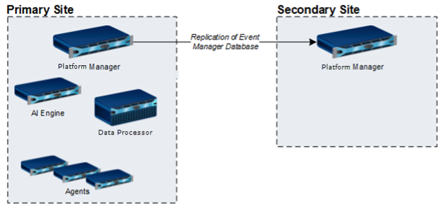

:::note
During failover, Agents installed on Data Indexers may not be accessible. Do not use them as primary collection points.
:::

The next example shows a scenario where the DR solution replicates all
LogRhythm databases on the Secondary site. This Secondary site also
includes a standby Data Indexer and AI Engine, in case the key SIEM
components on the Primary site are unavailable for a long period of
time. In addition, the Archives are manually backed up to another system
or replicated in a SAN. Archives are available to Data Indexers in the
Primary site and the Secondary site.

#### Example 2: Full protection with minimal disruption

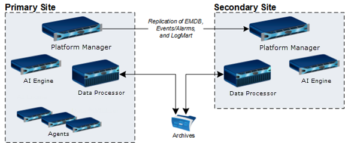

### DNS infrastructure

All components at the Primary and Secondary sites must use a common DNS
infrastructure. Follow these guidelines when configuring DNS:

- **Platform Managers:** A common DNS record can point to either the IP
  address of the Primary Platform Manager or the IP address of the
  Secondary Platform Manager.

- **Data Indexers and AI Engines:** Configure Data Indexers and AI
  Engines to connect to the Platform Manager by DNS name rather than IP
  address. Remote Data Indexers and AI Engines should also support DNS
  to connect to either the Primary or Secondary site.

- **Agents:** Agents can use DNS to identify new Mediator host
  connections. The Agent resolves the DNS name to an IP address for each
  new connection attempt. You can also redirect Agents to new Data
  Indexers by using the Deployment Manager in the SIEM Console.

### Overview of the failover process

The failover process depends on whether the Primary site was shut down
as planned or went down unexpectedly. In either case, you must manually
initiate failover as described below:

1. Manually initiate the failover, using the appropriate process:

    - **Planned failover:** Go to the *Primary* (active) site and use
      the DR solution to initiate the failover to the standby site.

    - **Unplanned failover:** Go to the *Secondary* (standby) site and
      use the DR solution to initiate the failover to the standby site.

1. Update the common DNS record so the Primary site components point to
    the IP address of the Secondary Platform Manager. When the time to
    live (TTL) expires, the systems at the Primary site reconnect to the
    newly activated Platform Manager.

1. If a Data Indexer is unavailable on the Primary site, reconnect
    Agents to a new Data Indexer by changing the DNS records or using
    the Deployment Manager in the SIEM Console.

    For detailed instructions, see the *LogRhythm Disaster Recovery
    Administration Guide*.

    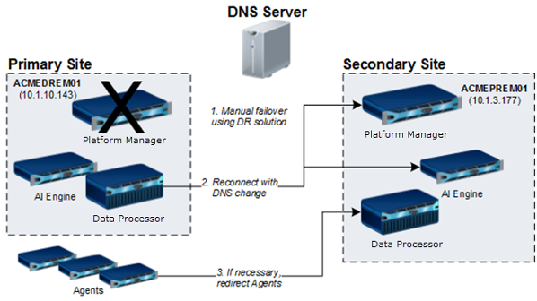

## Preparation

Before you install the DR solution, make sure the environment meets the
prerequisites in the following table.

| Requirement                           | Details                                                                                                                                                                                                                                                                                                                                                                               |
| :------------------------------------ | :------------------------------------------------------------------------------------------------------------------------------------------------------------------------------------------------------------------------------------------------------------------------------------------------------------------------------------------------------------------------------------ |
| LogRhythm SIEM                        | Deploy the same LogRhythm software version at the Primary and Secondary sites.                                                                                                                                                                                                                                                                                                        |
| SQL Server and SQL Server Agent       | Run the SQL Server and SQL Server Agent services under the same account at both sites. Use a domain account or identical local user accounts.                                                                                                                                                                                                                                         |
| Network                               | A dedicated replication network is recommended to isolate replication traffic. Configure replication IP addresses on dedicated interfaces; they do not need to be on the same subnet. The network must support 10 Mbs/second bandwidth and a maximum latency of 150 milliseconds.                                                                                                     |
| Ports and firewall                    | Keep the replication ports open between the sites. DR Setup opens ports blocked by Windows Firewall, but it does not configure other firewalls.                                                                                                                                                                                                                                       |
| DNS                                   | Configure a common DNS record that can point to either Platform Manager. Configure Data Indexers and AI Engines to use a DNS name for the Platform Manager. DNS zones must span both sites. Configure DNS address records with a two-minute time to live (TTL) for faster failover. A shared name for Data Indexers and AI Engines is optional.                                       |
| Platform Manager disk space           | During setup, back up the Primary Platform Manager databases and copy them to the Secondary system. The installer checks database sizes and estimates the required disk space. You can use a network drive if the SQL Server Agent service account has write access to the share. **Note:** The backup can take several hours, depending on data volume and backup media write speed. |
| Existing High Availability deployment | If you are adding DR to an existing LogRhythm High Availability deployment, complete the additional preparation steps in Appendix A and the installation and configuration steps in Appendix B.                                                                                                                                                                                       |

## Installation and configuration

Follow these steps to install and configure the Disaster Recovery
solution at the Primary and Secondary sites.

:::note
During DR configuration, the setup routine stops the Platform Manager services. You do not need to stop any services yourself.
:::

### Configure the Primary Platform Manager

To configure the Primary site:

:::important
Use only static IP addresses for the replication interface. Do not use DHCP.
:::

1. Download the DR zip file from the LogRhythm Support Portal and
    extract it on the Primary Platform Manager.

1. Browse to the newly extracted **DR** directory.

1. Right-click **DR_Setup** and select **Run as administrator**. Enter
    your local system administrator credentials.

1. In the first DR Setup dialog, enter credentials for a SQL System
    Admin or enable the Windows Authentication check box. Select
    **Next**.

    :::note
    The account you enter must have the `sysadmin` role in SQL Server. To verify its permissions, connect to SQL Server Management Studio (SSMS). In Object Explorer, expand **Security > Logins**, select the user (or create one), and open **Properties**. Select **Server Roles** and verify that **sysadmin** is selected.
    :::

    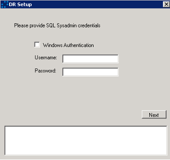

1. Select **Primary**, then select **Next**.

    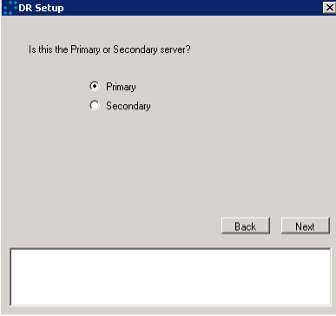

1. Under **Primary**, select the IP address for the Primary site. Use
    the drop-down arrow to select a discovered IP address.

1. Under **Secondary**, enter the IP address of the Secondary site. You
    can select a different port number if the port is not used by
    another system. The Primary and Secondary sites can use different
    ports.

1. Select **Next**.

    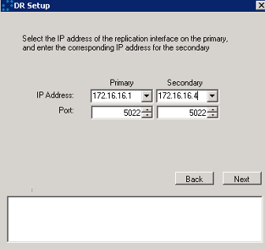

1. Select the databases to replicate at the Secondary site, then select
    **Next**. By default, you must select the **EMDB** (Platform Manager
    database). The Events and Alarms databases must be selected
    together.

    :::important
    The DR solution does not replicate LogRhythm Archives.
    :::

    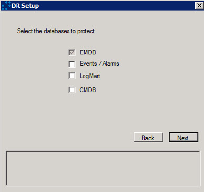

1. Select a folder for temporarily storing the database backup, then
    select **Next**.

    After you select the folder, DR Setup displays the available free
    space. If there is not enough space for the backup, an error message
    appears at the bottom of the dialog. If necessary, select a network
    drive or external drive. To change your database selections, select
    **Back** to return to the previous screen.

    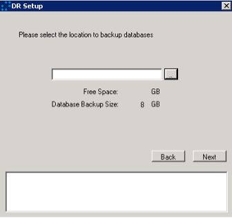

1. Select the desired Recovery Point Objective (RPO) in minutes. The
    RPO is the maximum tolerable period during which data from the
    Primary system can be lost because of a disruption. If data
    replication falls behind this limit, LogRhythm SIEM generates an
    alert. The default is 60 minutes.

    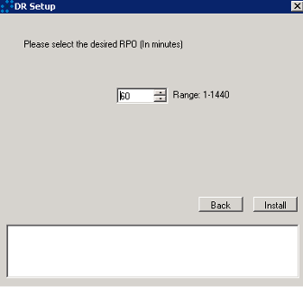

1. Select **Install** to back up the Platform Manager databases and install the DR solution on the Primary system.

    DR Setup launches a script that displays its progress. Depending on
    the database sizes, this process can take several hours. When it is
    complete, the following prompt appears:

    `Press Enter when the setup is complete on the secondary system`

1. Keep this progress window open. You will return to it later, after completing the setup on the secondary Platform Manager.

    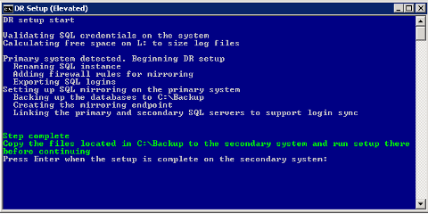

### Transfer database files to the Secondary site

When the setup completes on the Primary system, copy the database backup files to the Secondary system.

1. Open the folder where the backup files are stored on the Primary system.

1. Select and copy all the database files and the **logins** file, similar to the following example.

    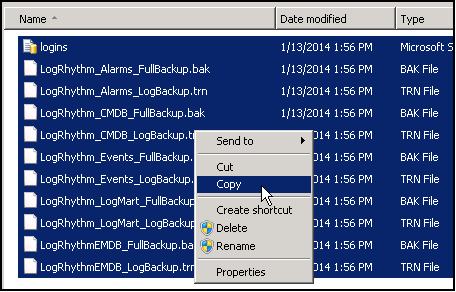

1. Access the Secondary Platform Manager server and paste the files into
    a folder. You will load the files from this folder when you
    configure the Secondary Platform Manager.

### Configure the Secondary Platform Manager

To configure the Secondary site:

1. Extract the DR zip file on the Secondary Platform Manager.

1. Browse to the newly extracted DR folder.

1. Right-click **DR_Setup** and select **Run as administrator**. Enter your local system administrator credentials.

1. In the first DR Setup dialog, enter credentials for a SQL Server
    system administrator, or select the Windows Authentication check
    box. Then select **Next**.

    :::note
    The account you enter must have the `sysadmin` role in SQL Server. To verify its permissions, connect to SQL Server Management Studio (SSMS). In Object Explorer, expand **Security > Logins**, select the user (or create one), and open **Properties**. Select **Server Roles** and verify that **sysadmin** is selected.
    :::

1. Select **Secondary** and select **Next**.

    :::note
    If you leave this setting at **Primary**, DR Setup will fail. Rerun DR Setup on the Secondary system and select **Secondary**.
    :::

    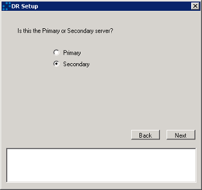

1. Under **Primary**, enter the Primary site's IP address. Make sure
    the Primary port number matches the one you selected during Primary
    site configuration. Under **Secondary**, select the Secondary
    site's IP address. Use the drop-down arrow to select a discovered IP
    address. Make sure the Secondary port number matches the one you
    selected during Primary site configuration. Then select **Next**.

    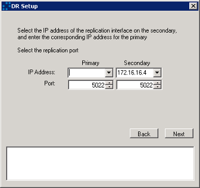

1. Select the folder where you copied the Platform Manager databases,
    then select **Next**.

    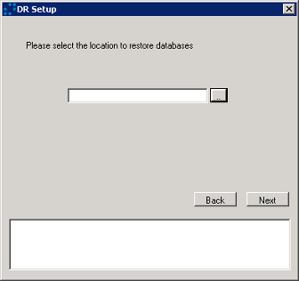

1. Select the desired Recovery Point Objective (RPO) in minutes for the
    Secondary Platform Manager. The default is 60 minutes. This value
    does not need to match the RPO selected for the Primary Platform
    Manager.

1. Select **Install**.

    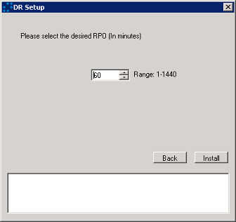

1. When the **Step complete** message appears, press **Enter** to exit.

    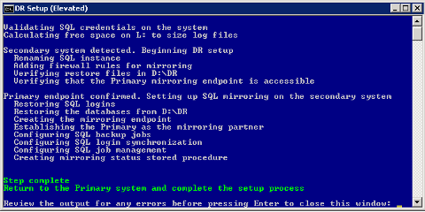

    You are now done with setup on the Secondary site.

    :::note:** Do not start the Platform Manager's Job Manager and ARM services on the Secondary site. Leave both services set to **Manual** unless you need to fail over to the Secondary site. For details, see the *LogRhythm Disaster Recovery Administration Guide*.
    :::

### Complete setup on the Primary Platform Manager

After completing the setup on the Secondary site, follow these steps:

1. On the Primary Platform Manager, return to the DR Setup progress window.

1. Press **Enter** to complete the setup on the Primary system.

    :::note
    If setup fails, check the log files in the **Logs** subdirectory.
    :::

    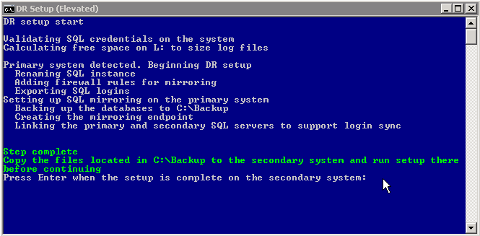

    When the "DR Setup Complete" message appears, you are finished with the DR configuration.

    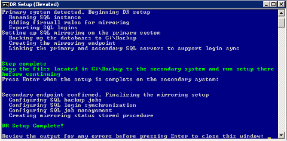

1. If desired, remove the backup files you created on both the Primary
    and Secondary Platform Managers. These files are no longer needed.

1. Restart all LogRhythm services running on AI Engines, Data Indexers,
    and the Platform Manager at the **Primary** site, not the Secondary
    site. These services include:

    - Platform Manager: Job Manager service and ARM service

    - Data Indexers: Mediator service

    - AI Engine (if integrated): AI Engine service and AI Engine Communication Manager service

### Register LogRhythm databases in SQL Server

To view data replication status in the SQL Database Mirroring Monitor,
you must first register the LogRhythm databases.

1. On the Primary Platform Manager server, select **Start > All Programs > LogRhythm > Disaster Recovery**.

1. Double-click **DR_Status** to open Database Mirroring Monitor.

1. Select **Action > Register Mirrored Database**.

    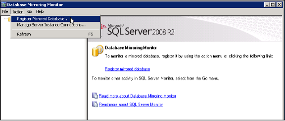

1. In the Register Mirrored Database dialog, select **Connect**.

    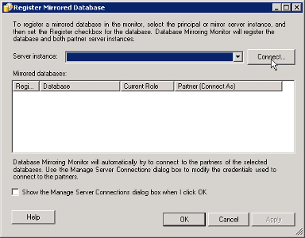

1. Enter credentials for the SQL Server administrator, then select
    **Connect**.

1. In the Register Mirrored Database dialog, select the check boxes for
    all databases. Select the **Show the Manage Server Connections**
    check box, then select **OK**.

    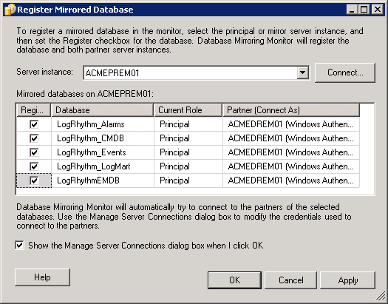

1. At the next prompt about Server Instance Connections, select
    **OK** again.

1. In the Database Mirroring Monitor panel, select the plus sign to
    expand the list of mirrored databases.

    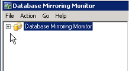

    The LogRhythm databases now appear in Database Mirroring Monitor.

    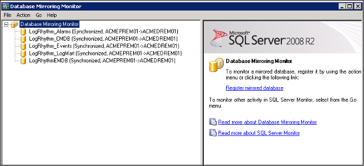

1. Go to the Secondary Platform Manager and follow the previous steps
    to register the mirrored databases.

1. After you register the Primary and Secondary databases, select a
    database in the left panel to view its status. For more information
    about Database Mirroring Monitor, see the *LogRhythm Disaster
    Recovery Administration Guide*.

    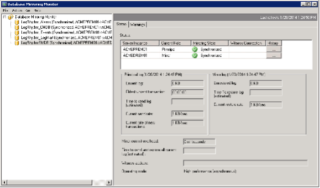

1. Install DX on both the Primary and Secondary machines.

1. Use the DNS name for the AllConf EMDB location on the DR side.

1. Point the DP on the DR side to the `logrhythm` cluster.

    note
    You can also view replication status by running LogRhythm's **DR Control**. Select **Start > All Programs > LogRhythm > Disaster Recovery**, right-click **DR Control**, and select **Run as administrator**. For more information, see the *LogRhythm Disaster Recovery Administration Guide*.
    :::

    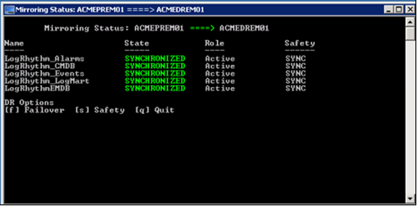

## Disaster Recovery test

Test the DR solution by running a failover and a failback scenario. See
the *LogRhythm Disaster Recovery Administration Guide* for instructions
on running these scenarios.

## Appendix A: Preparation on an HA system

Perform all the preparation steps above on both nodes of the High
Availability (HA) system. Each node needs a dedicated replication
interface on the same subnet.

Create a LifeKeeper resource for the shared IP address of the
replication interface.

1. Open the LifeKeeper GUI as an administrator.

1. Right-click the active node and select **Create Resource Hierarchy**.

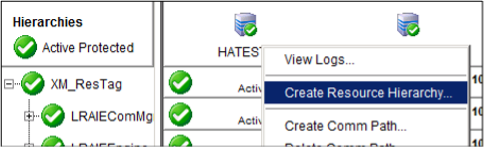

1. Follow the wizard steps:

    a. Select **Next** on the first screen.

    b. Select **IP Address** for the application to protect.

    c. Enter a valid IP address on the same subnet as the replication
        interfaces.

    d. Select the correct subnet mask.

    e. Provide a resource tag name (for example,
        `172.16.21.5_ResTag`).

    f. Choose the replication interface.

    g. Do not enable local recovery.

    h. The resource is created, and the Extend Wizard starts
       automatically to extend the hierarchy to the standby node.

    i. Select the correct subnet mask.

    j. Choose the replication interface.

    k. Accept the defaults on the remaining screens.

1. Right-click the SQL resource and select **Add Dependency**. Add the
    new resource as a dependency for the SQL resource.

    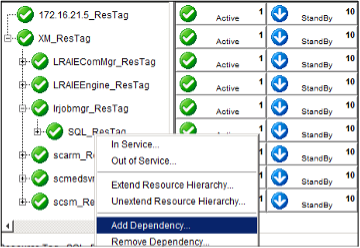

1. Follow the wizard steps. Select the new IP resource as the **Child
    Resource** and accept the defaults for the remaining settings.

## Appendix B: Installation and configuration on an HA system

Perform all the installation and configuration steps above, using the
active HA node as the Primary DR system. Use the shared IP address
created in Appendix A as the DR Primary IP address.

1. After DR setup is complete, use the LifeKeeper GUI to fail over the
    resource hierarchy to the HA secondary system. On that system,
    extract the DR zip file and browse to the **DR\\bin** directory.

1. Right-click **HA_DR_Setup.ps1** and select **Run with PowerShell**.

1. When the **DR Setup Complete** message appears, press **Enter** to
    close the window. Then use the LifeKeeper GUI to fail back to the HA
    primary system.

## Appendix C: Configure LogRhythm for HA+DR

Follow the standard HA+DR instructions, with these changes:

:::note
Follow these instructions only for HA+DR.
:::

- Install HA as usual, using the `192.168.33.x` addresses for the
  private network.

- Configure LogRhythm as follows:

  - Configure the Agent on the DR side to point to the DR Secondary
    machine's IP address.

  - Use the DNS name for the AllConf EMDB location on the HA side.

  - Use the shared IP address for the AllConf Public IP.

  - Use the HA shared name and IP address in the console's new
    deployment wizard.

    - Configure the **Platform Manager** on the HA side to point to the
      shared IP address.

    - Configure the **Platform Manager** on the DR side to point to the
      DR IP address.

    - Configure the **Data Processor** on the HA side to point to the
      DNS name.

    - Configure the **Data Processor** on the DR side to point to the
      DNS name.

    - Configure AIE on the HA side to point to the DNS name.

    - Configure AID on the DR side to point to the DNS name.

    - Configure the Agent on the HA side to point to the shared IP
      address.

  - Use the DNS name for the AllConf EMDB location on the DR side.

  - Change the AllConf ElasticSearch clustername value on the DR side to
    `logrhythmdr`.

  - Add the DR secondary machine entity on the **Entity** tab of
    Deployment Manager, and create a Data Indexer for the DR secondary
    machine.

  - Point the DP on the HA side to the `logrhythm` cluster.

  - Point the DP on the DR side to the `logrhythmdr` cluster.
